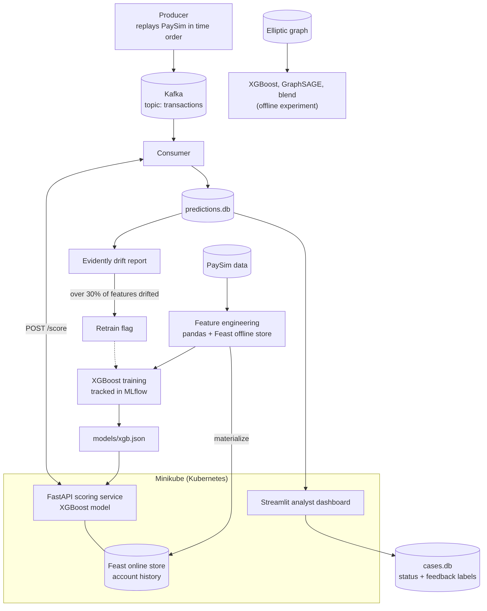
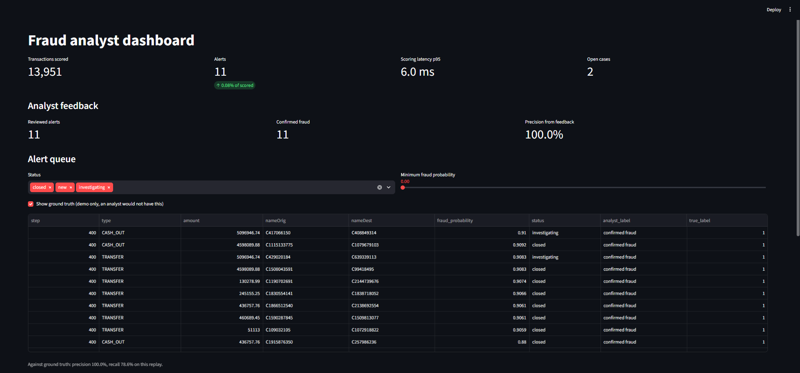
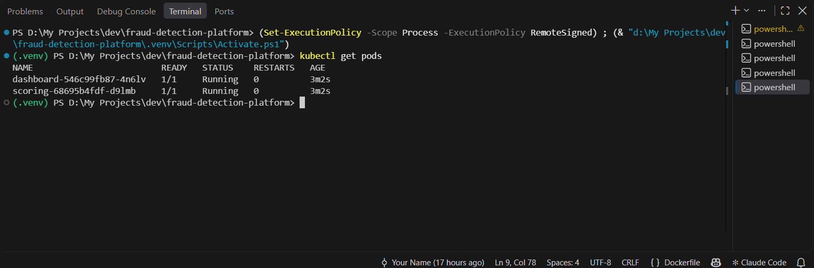
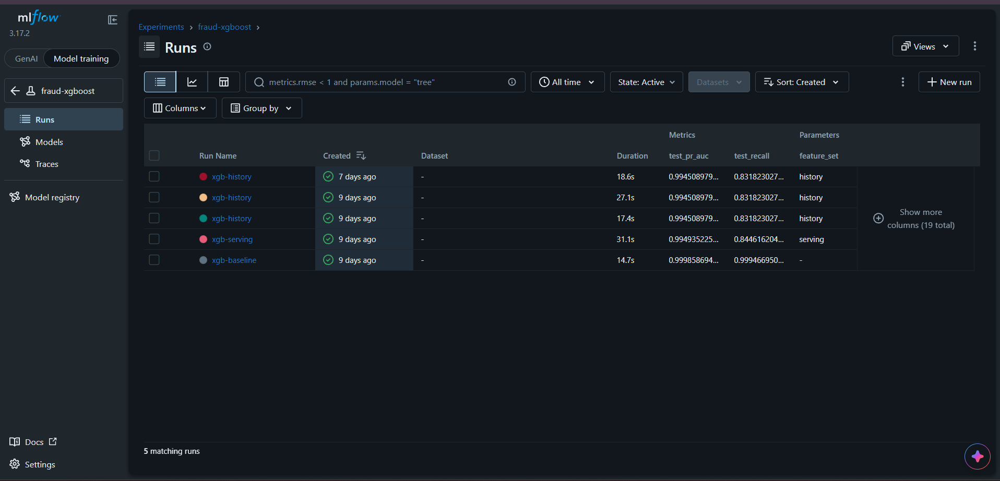
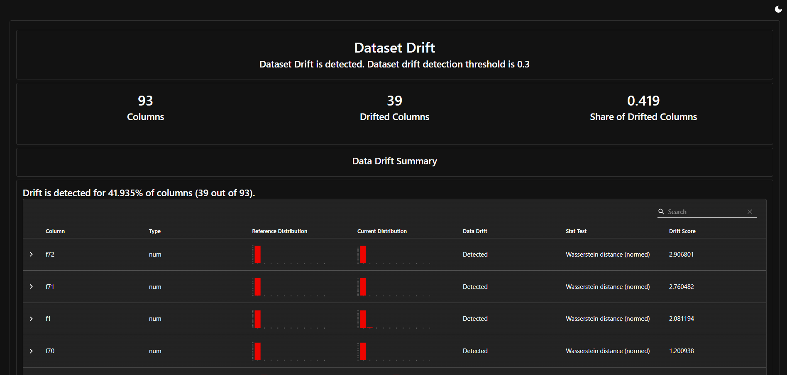

# Real-Time Financial Fraud Detection Platform

A system that reads live transactions from Kafka, scores each one for fraud risk in a few milliseconds, and shows analysts a dashboard where they review alerts and give feedback labels. A separate experiment tests whether a graph neural network can find fraud rings.

Built as capstone project AIML-01 (AI / Machine Learning track).

## What is in here

| Part | Tools | Status |
|---|---|---|
| Data exploration and features | pandas, PaySim | done |
| Feature store, same features for training and serving | Feast | done, verified against pandas |
| Fraud model with class weights, tracked runs | XGBoost, MLflow | done |
| Streaming: replay, scoring, latency benchmark | Kafka, FastAPI | done |
| Graph model on a real transaction graph | PyTorch Geometric, Elliptic dataset | done (offline) |
| Drift reports and retrain trigger | Evidently AI | done |
| Analyst dashboard with case status and feedback labels | Streamlit | done |
| Deployment | Docker, Kubernetes (Minikube) | scoring service and dashboard deployed |

## Architecture



More detail in [docs/ARCHITECTURE.md](docs/ARCHITECTURE.md). Request, feature and table definitions are in [docs/API.md](docs/API.md).

## Results

### PaySim, live fraud scoring

PaySim has 6,362,620 transactions, of which 8,213 are fraud (0.13%). Fraud only occurs in `TRANSFER` and `CASH_OUT`, so the model is trained on those two types (2,770,409 rows, 0.30% fraud). The split is by time: train on steps below 350, validate on 350-399, test on 400 and later. The test fraud rate is 1.47%, so PR-AUC is always read next to that base rate.

| Model | Test PR-AUC | Precision | Recall |
|---|---|---|---|
| Leaky features (balances after the transaction) | 0.9999 | 1.000 | 0.9995 |
| Serving-time features | 0.9949 | 0.9965 | 0.8446 |
| Serving-time features + account history (deployed) | 0.9945 | 0.9971 | 0.8318 |

The first row is not a real result. Those features contain balances after the transaction, which the live system cannot know, so they were removed and the model retrained. The account-history features did not improve the score on PaySim, because senders appear about once and fraud goes to nearly all-different receivers. They stay in the pipeline because they are what the Feast feature store serves.

PaySim is synthetic and its fraud follows a simple rule (drain an account through a transfer or cash-out), so scores this high should not be expected on real data.

**Training and serving use the same features.** Feast and the pandas training features return identical values: 0 mismatches over 2,000 sampled transactions (`src/features/verify_feast.py`).

**Streaming replay through Kafka and the API:**

| Measure | Result |
|---|---|
| Scoring service latency (5,000-message replay, 2,421 scored) | p50 4.1 ms, p95 6.6 ms, p99 7.6 ms |
| End to end, Kafka + API, at 200 messages per second (first 200 messages excluded) | p50 55 ms, p95 70 ms, p99 82 ms |
| Accuracy on a 30,000-message replay (13,951 scored, 14 true fraud) | 11 caught, 3 missed, 0 false alarms |

The 30,000-message replay covers only step 400 of the simulation, so it is a check that serving matches training (recall 0.79 against 0.83 offline), not a new test set.

### Elliptic, graph model for fraud rings

PaySim has almost no ring structure (8,213 fraud transactions go to 8,169 different receivers), so the graph experiment uses the Elliptic Bitcoin graph: 203,769 transactions, 234,355 edges, 46,564 labeled (4,545 illicit). Train on time steps 1-29, validate on 30-34, test on 35-49. Test PR-AUC:

| Model | Steps 35-42 | Steps 43-49 | All 35-49 |
|---|---|---|---|
| XGBoost, all 165 features | 0.914 | 0.033 | 0.789 |
| GraphSAGE, all 165 features | 0.666 | 0.030 | 0.536 |
| Blend (35% GraphSAGE) | 0.910 | 0.032 | 0.779 |
| XGBoost, 93 local features only | 0.900 | 0.025 | 0.768 |
| GraphSAGE, 93 local features only | 0.852 | 0.031 | 0.521 |

The base rate is 0.092 for steps 35-42 and 0.025 for steps 43-49.

- The graph model did not beat XGBoost on ranking. The blend gives a more precise operating point at the same recall (precision 0.929 against 0.857 on steps 35-42), but its PR-AUC is not higher.
- All models fall to chance after step 43. This is the known dark-market shutdown in the Elliptic data, and it is a concept change: the illicit patterns the models learned disappear.
- Every number is from one training run, with no confidence intervals. The GraphSAGE training curves were noisy.
- The graph model is evaluated offline and is not wired into the live PaySim stream, because the two datasets are different.

### Drift monitoring

| Comparison | Features drifted | Model accuracy in that window |
|---|---|---|
| PaySim, steps 400+ against training | 20% of 5 (below the 30% trigger) | not applicable |
| Elliptic, steps 35-42 against training | 61% of 93 | PR-AUC 0.914, works well |
| Elliptic, steps 43-49 against training | 42% of 93 | PR-AUC 0.033, collapses |

Feature drift alone did not predict the failure: the window with less drift is the one where the model broke. For that reason the dashboard collects analyst labels, so precision can be tracked on recent alerts as a second signal. The 30% trigger also fires on the healthy 35-42 window, so it is a starting point and not a tuned rule.

## Screenshots

| | |
|---|---|
|  |  |
| Analyst dashboard with a reviewed case | Both services running in Minikube |
|  |  |
| MLflow runs | Evidently drift report |

## Setup and how to run

Tested on Windows 11 with PowerShell, Python 3.10, Docker Desktop and Minikube. Commands run from the project root.

### 1. Environment

```powershell
python -m venv .venv
.venv\Scripts\activate
python -m pip install -r requirements.txt
```

### 2. Data (not in the repository)

- PaySim from Kaggle (`ealaxi/paysim1`): save the CSV as `data/paysim.csv`.
- Elliptic Data Set from Kaggle: save the three CSVs in `data/elliptic/`.

### 3. Train the PaySim model

```powershell
python -m src.models.train_xgb --features history
```

Saves `models/xgb.json` and logs the run to MLflow (`mlflow ui`, then open http://localhost:5000). Use `--features serving` or `--features all` to reproduce the other rows of the results table.

### 4. Feature store

```powershell
python -m src.features.build_feast_data
cd feature_repo
feast apply
feast materialize 2026-01-01T00:00:00 2026-01-17T16:00:01
cd ..
python -m src.features.verify_feast
```

The online store is filled up to step 400 on purpose: the replay starts at step 400, and a later store would leak the future into earlier transactions.

### 5. Kafka

```powershell
docker compose up -d
docker exec kafka /opt/kafka/bin/kafka-topics.sh --create --topic transactions --bootstrap-server localhost:9092
```

### 6. Scoring service and replay

Use three terminals. Restart the scoring service before every replay, because it keeps recent account history in memory.

```powershell
# terminal A
uvicorn src.serving.app:app --port 8000
# Terminal B wait for "read then start the producer now"
python -m src.streaming.consumer --max 5000
# terminal C
python -m src.streaming.producer --limit 5000 --rate 200
```

Then `python -m src.streaming.evaluate_stream` prints precision, recall and latency percentiles from the saved predictions.

### 7. Dashboard

```powershell
python -m streamlit run dashboard/app.py
```

### 8. Drift reports

```powershell
python -m src.monitoring.drift paysim
python -m src.monitoring.drift elliptic
```

Reports are saved in `reports/`. When more than 30% of features drift, a flag is written to `data/retrain_flag.json`. Adding `--run-retrain` also starts the training script. Nothing runs on a schedule yet.

### 9. Graph experiments (Elliptic)

```powershell
python -m src.graph.train_xgb_elliptic
python -m src.graph.train_gnn
python -m src.graph.blend
python -m src.graph.train_xgb_elliptic --local-only
python -m src.graph.train_gnn --local-only
```

### 10. Kubernetes (Minikube)

Docker Desktop must be running. The replay in step 6 must have produced `data/predictions.db`, which is copied into the dashboard image as a snapshot.

```powershell
minikube start --driver=docker --memory=4096 --cpus=4
docker build -f Dockerfile.scoring -t fraud-scoring:0.1 .
docker build -f Dockerfile.dashboard -t fraud-dashboard:0.1 .
minikube image load fraud-scoring:0.1
minikube image load fraud-dashboard:0.1
kubectl apply -f k8s/
kubectl get pods
kubectl port-forward svc/scoring 8000:8000
kubectl port-forward svc/dashboard 8501:8501
```

The scoring service then answers on http://localhost:8000 and the dashboard on http://localhost:8501. Kafka stays in docker-compose, and the producer and consumer run on the laptop and call the API through the port-forward.

### 11. Tests

```powershell
python -m pip install -r requirements-dev.txt
python -m pytest
```

The feature and drift tests run anywhere. The API tests are skipped unless `models/xgb.json` and the Feast online store exist (steps 3 and 4).

## Repository layout

```
src/features/    feature engineering, Feast data builder, Feast check
src/models/      PaySim XGBoost training with MLflow
src/serving/     FastAPI scoring service
src/streaming/   Kafka producer, consumer, stream evaluation
src/monitoring/  Evidently drift reports and retrain trigger
src/graph/       Elliptic loader, XGBoost, GraphSAGE, blend
dashboard/       Streamlit analyst dashboard
feature_repo/    Feast definitions
k8s/             Kubernetes manifests
notebooks/       EDA and feature notebooks
reports/         saved drift reports
tests/           pytest tests
docs/            architecture and API documentation
```

## Limitations and next steps

- PaySim is synthetic. The very high scores say more about the data than about the model.
- The scoring service keeps recent account history in memory, so it runs as a single replica and loses that history on restart. A production version would write it to a shared store such as Redis or Feast's online store.
- Kafka runs in docker-compose, not in the Kubernetes cluster.
- The dashboard in Kubernetes shows a snapshot of one replay, and case reviews are lost when its pod restarts.
- The retrain trigger writes a flag and can start training, but there is no scheduler, and a retrained model is not rolled out automatically.
- The graph model is evaluated offline on a different dataset, and results come from single runs. Not yet tested: removing the graph edges to prove how much they contribute.
- Next: label-based performance monitoring in the drift step, a threshold tuned on analyst feedback, and the graph score inside the live pipeline on a dataset with real ring structure.
