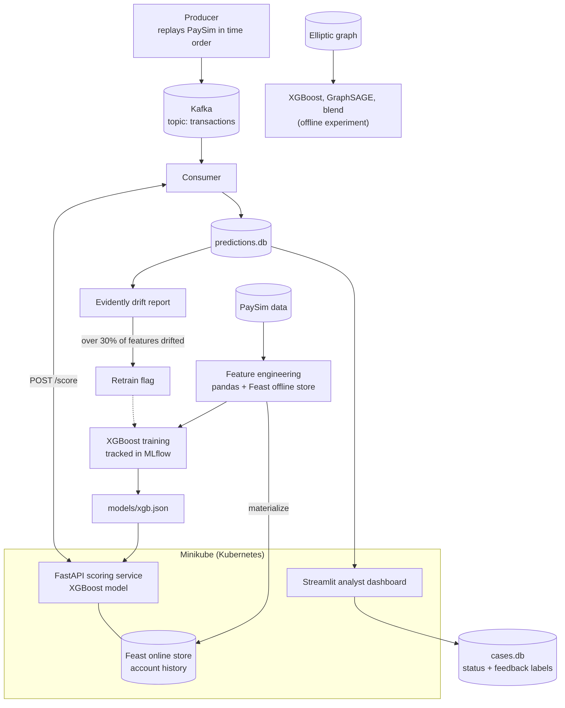

# Architecture

## Components

| Component | What it does | Where it runs |
|---|---|---|
| Producer (`src/streaming/producer.py`) | Replays PaySim transactions from step 400 onward into the Kafka topic `transactions`, in time order | Laptop |
| Kafka | Message pipe, one partition so the order of transactions is kept | docker-compose |
| Consumer (`src/streaming/consumer.py`) | Reads each message, calls the scoring API, stores the result and the latency in `data/predictions.db` | Laptop |
| Scoring service (`src/serving/app.py`) | Builds the features for one transaction (Feast history plus request fields), scores it with XGBoost, returns probability and flag | Minikube |
| Feast (`feature_repo/`) | Holds cumulative send/receive history per account. Offline store: Parquet. Online store: SQLite | Offline: laptop. Online: inside the scoring image |
| Dashboard (`dashboard/app.py`) | Alert queue, case review, analyst feedback labels, precision from feedback | Minikube |
| Training (`src/models/train_xgb.py`) | Trains XGBoost with class weights, logs every run to MLflow, saves `models/xgb.json` | Laptop |
| Drift check (`src/monitoring/drift.py`) | Evidently report; writes a retrain flag when more than 30% of features drift | Laptop |
| Graph experiments (`src/graph/`) | XGBoost, GraphSAGE and a blended score on the Elliptic Bitcoin graph | Laptop (offline) |

## Design decisions

1. **Serving-time features only.** The first model used post-transaction balances and scored PR-AUC 1.0. The live API cannot know those numbers, so they were removed and the model was retrained. A unit test (`tests/test_features.py`) guards against this coming back.
2. **Time-based split.** Train on steps below 350, validate on 350-399, test on 400 and later. A random split would let the model see the future.
3. **Point-in-time history.** Feature values for a transaction at step t count only activity from earlier steps. Feast and pandas return identical values (0 mismatches over 2,000 transactions, see `src/features/verify_feast.py`).
4. **Online store frozen at step 400.** The scoring service adds what it has seen since then in memory, so a replayed transaction never sees the future. Because of this the service runs a single replica.
5. **Graph model on Elliptic, not PaySim.** PaySim fraud goes to almost entirely different receivers (8,213 fraud transactions, 8,169 distinct receivers), so there is no ring structure to learn from.
6. **Drift plus labels.** Drift alerts alone are not enough, see the Elliptic result in the README. The dashboard collects analyst labels so precision can be tracked on recent alerts.
